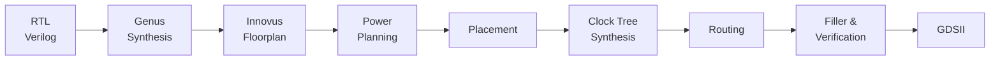

# RISC-V Single-Cycle CPU (RTL to GDSII)

A 32-bit single-cycle RISC-V processor core written in Verilog and implemented
with Cadence Genus 21.14 (synthesis) and Cadence Innovus 21.15 (place and route)
on a 90 nm generic PDK (`gsclib090`).

## What it does
The CPU fetches one instruction per clock, decodes it, executes it, and writes
the result back, all in a single cycle. Instruction and data memory are
external; the core exposes them as ports (`PC`/`Instr` and
`ALUResult`/`WriteData`/`MemWrite`/`ReadData`).

**Supported instructions:** `lw`, `sw`, `add`, `sub`, `and`, `or`, `slt`,
`addi`, `andi`, `ori`, `slti`, `beq`, `jal`.

**Main blocks:** ALU, register file (32 x 32-bit, x0 = 0), immediate
extender, main decoder, ALU decoder, program counter and adders.

## Results
| Metric | Value |
|---|---|
| Clock constraint | 6.2 ns (about 161 MHz) |
| Cell area (synthesis) | 36,792 um^2 (3,750 cells) |
| Power (Genus estimate) | 6.27 mW |
| Die size | 290 x 290 um |
| Post-route setup WNS | +0.003 ns |
| Post-route hold WNS | +0.055 ns |

## Repository layout
| Folder | Contents |
|---|---|
| `rtl/` | Verilog sources (top: `riscvsingle`) |
| `constraints/` | SDC timing constraints |
| `scripts/` | Genus and Innovus scripts, GDS layer map |
| `results/` | Netlists, reports, final GDSII |
| `docs/` | Design calculations and flow screenshots (`docs/images/`) |

## Flow

The design goes from RTL to GDSII in two tools: **Cadence Genus** for logic synthesis, then **Cadence Innovus** for physical implementation.

### 1. Synthesis (Cadence Genus)

| Step | What happens |
|---|---|
| Read inputs | Liberty timing library and the 12 RTL files in `rtl/` |
| Elaborate | Build the design hierarchy with `riscvsingle` as top module |
| Constraints | Apply clock and I/O timing from `constraints/constraint.g` (6.2 ns clock) |
| Generic synthesis | Convert RTL to technology-independent logic |
| Mapping | Map logic to the standard-cell library |
| Optimization | Optimize timing, area and power (medium effort) |
| Outputs | Gate-level netlist, SDC, and area / power / timing reports in `results/` |

Script: `scripts/run.tcl`

### 2. Physical Implementation (Cadence Innovus)

| Stage | What happens |
|---|---|
| Design import | Load the netlist, SDC, LEF files and the timing views (best case for hold, worst case for setup) from `scripts/Default.view` |
| Floorplan | 290 × 290 µm die at about 70% target utilization |
| Power planning | Power rings and stripes on the upper metal layers, then power-rail routing to the standard cells |
| Placement | Place standard cells, then pre-CTS timing optimization |
| Clock tree synthesis | Build the clock tree using the settings in `scripts/ccopt.spec`, then post-CTS optimization |
| Routing | Signal routing on Metal1–Metal9, then post-route optimization for setup and hold |
| Filler insertion | Add filler cells to fill empty standard-cell rows |
| Verification | DRC and connectivity checks, plus post-route timing reports |
| Stream out | Write the layout as GDSII using the layer map in `scripts/streamOut.map` |

Script: `scripts/innovus_flow.tcl`

### Outputs

| File | Description |
|---|---|
| `results/riscvsingle_netlist.v` | Gate-level netlist from Genus |
| `results/riscvsingle_out.sdc` | Constraints written by Genus |
| `results/riscvsingle_postlayout.v` | Post-layout netlist from Innovus |
| `results/riscvsingle.gds` | Final GDSII layout |
| `results/*.rpt` | Area, power and timing reports |
| `docs/images/` | Screenshots of each stage |

## Requirements
Cadence Genus and Innovus licenses, plus the 90 nm PDK (Liberty, LEF, cap table),
which are not included. Update the PDK paths in `scripts/run.tcl` and
`scripts/Default.view` to match your machine.

